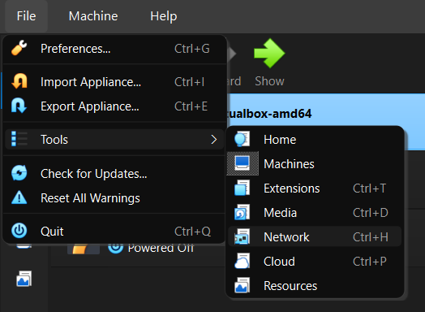
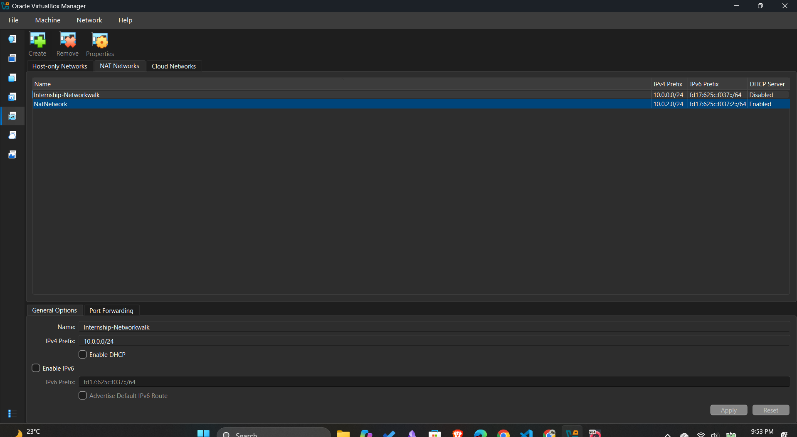
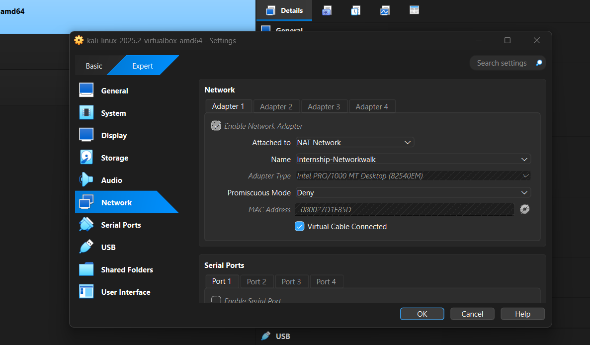
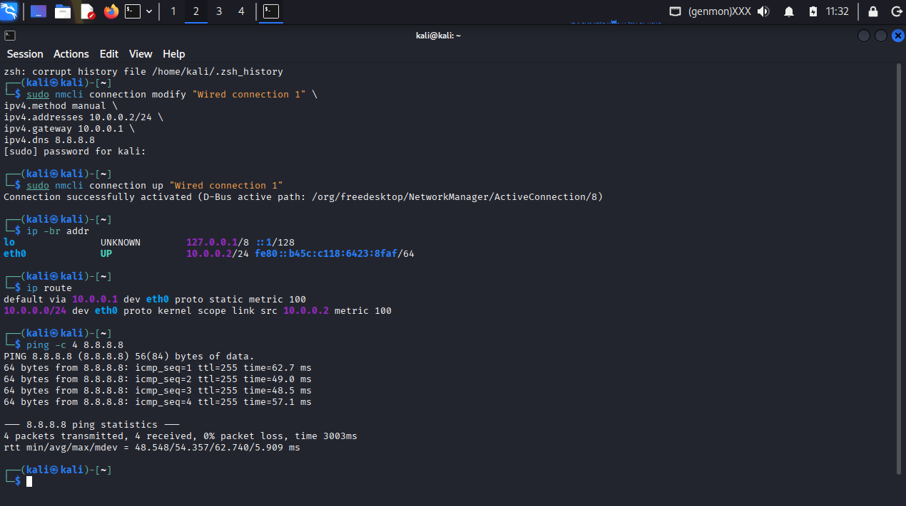
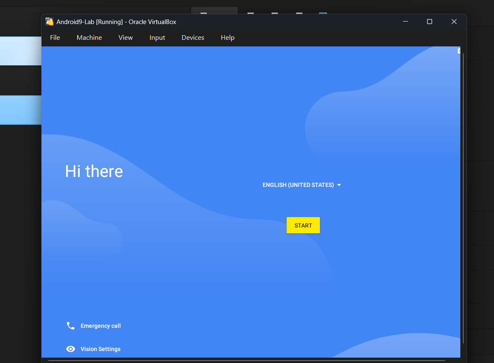
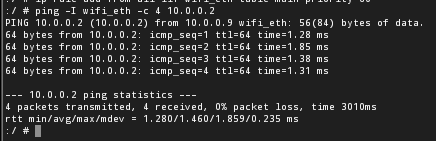
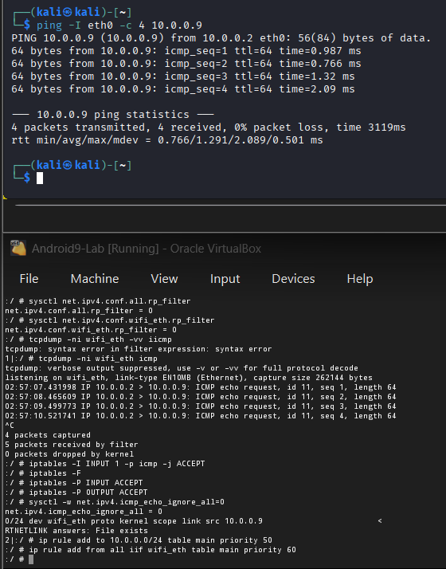
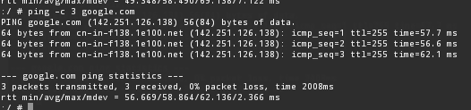
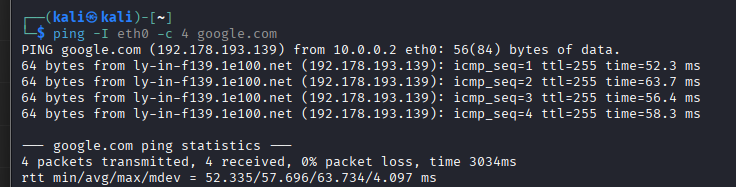

# WK1-PMx | Week1 Extra Projects - How to setup Android-x86 in VirtualBox 
<p align="center">
  
  
  
</p>

<p align="center">
  **Installing Android-x86 and Establishing Network Communication with Kali Linux**
</p>

---

## 1. Project Overview

This practical focuses on installing Android-x86 as a virtual machine in Oracle VirtualBox and establishing network communication between Android-x86 and Kali Linux.

The primary objective was to configure both virtual machines on the same VirtualBox NAT Network, assign static IPv4 addresses, establish communication, and verify internet connectivity.

During implementation, I encountered several networking issues involving routing tables, ARP, ICMP, firewall rules, and Android's DNS resolver.

I investigated these issues using Linux networking utilities, packet capture, routing corrections, and Android network configuration commands until connectivity was successfully established.

### Objectives

- Configure a shared VirtualBox NAT Network.
- Download and install Android-x86 9.0-r2.
- Configure Kali Linux and Android-x86 network interfaces.
- Assign static IPv4 addresses.
- Establish communication between both virtual machines.
- Configure internet connectivity and DNS.
- Troubleshoot routing and connectivity problems.
- Verify successful communication using ICMP and DNS tests.

### Tools & Technologies

| Tool | Purpose |
|---|---|
| Oracle VirtualBox | Virtual machine management |
| Kali Linux | Linux networking and testing |
| Android-x86 9.0-r2 | Android virtual machine |
| NAT Network | Virtual machine connectivity |
| Linux networking utilities | IP and routing configuration |
| tcpdump | Packet inspection |
| iptables | Firewall investigation |
| Android NDC | Native DNS resolver configuration |

---

## 2. Lab Environment

### Virtual Machines

| Configuration | Kali Linux | Android-x86 |
|---|---|---|
| Operating System | Kali Linux | Android-x86 9.0-r2 |
| Network Interface | eth0 | wifi_eth |
| IPv4 Address | 10.0.0.2 | 10.0.0.9 |
| Subnet Mask | /24 | /24 |
| Default Gateway | 10.0.0.1 | 10.0.0.1 |
| DNS Server | 8.8.8.8 | 8.8.8.8 |

### VirtualBox NAT Network

| Setting | Value |
|---|---|
| Network Name | Internship-Networkwalk |
| IPv4 Network | 10.0.0.0/24 |
| Gateway | 10.0.0.1 |
| DHCP Server | Disabled |
| Network Type | NAT Network |

---

## 3. Network Architecture

Both virtual machines were connected to the same VirtualBox NAT Network.

```text
                    INTERNET
                        |
                VirtualBox NAT
                        |
                 Gateway: 10.0.0.1
                        |
              NAT Network: 10.0.0.0/24
                        |
                 +------+------+
                 |             |
             Kali Linux    Android-x86
              10.0.0.2       10.0.0.9
                eth0          wifi_eth
                 |             |
                 +------+------+
                        |
                 Network Testing
                        |
                ICMP / ARP / DNS
```

---

## 4. Implementation

### Step 01 – Create a NAT Network in VirtualBox

Created a dedicated NAT Network using VirtualBox Network Manager.

Configured:

- Network name: Internship-Networkwalk
- IPv4 prefix: 10.0.0.0/24
- DHCP server: Disabled

Both virtual machines were connected to the same NAT Network.

**Screenshot 01 – NAT Network**



**Screenshot 02 – NAT Network Settings**



### Step 02 – Configure Kali Linux Network Adapter

Configured the Kali Linux virtual machine network adapter to connect to the newly created NAT Network.



### Step 03 – Configure Kali Linux Networking

Checked available interfaces and routing information.

```bash
ip -br addr
ip route
```

Network configuration:

```text
Interface : eth0
IP Address: 10.0.0.2/24
Gateway   : 10.0.0.1
DNS       : 8.8.8.8
```



### Step 04 – Verify Kali Internet Connectivity

```bash
ping -c 4 8.8.8.8
```


### Step 05 – Download Android-x86 9.0-r2

Downloaded the 64-bit Android-x86 9.0-r2 ISO image.

Official website: https://www.android-x86.org/


### Step 06 – Install Android-x86 in VirtualBox

Created a virtual machine named `Android9-Lab`.

Attached the Android-x86 ISO image and completed the installation.

The installation process included:

- Creating a virtual disk partition.
- Formatting the partition.
- Installing GRUB bootloader.
- Completing Android-x86 installation.
- Booting into Android.



### Step 07 – Configure Android Network Interface

Opened Android Terminal Emulator and obtained root access.

```bash
su
```

Identified the available network interfaces:

```bash
ip -br addr
```

The network interface used was:

```text
wifi_eth
```

Assigned a static IPv4 address:

```bash
ip addr flush dev wifi_eth
ip addr add 10.0.0.9/24 dev wifi_eth
ip link set wifi_eth up
```

Initial DNS property configuration:

```bash
setprop net.dns1 8.8.8.8
```

Verified:

```bash
ip -br addr
ip route
```


---

## 5. Initial Connectivity Testing

### Step 08 – Android to Kali Linux

Executed on Android:

```bash
ping -c 4 10.0.0.2
```

### Step 09 – Kali Linux to Android

Executed on Kali:

```bash
ping -c 4 10.0.0.9
```

Initial connectivity tests exposed problems with communication between the two virtual machines.





This led to further investigation of routing, ARP, ICMP, and firewall behavior.

---

## 6. Network Troubleshooting

### 6.1 Interface Inspection

```bash
ip -br addr
ip link show
```

Inspected interface status and assigned IP addresses.

### 6.2 ARP and Neighbor Table Investigation

```bash
ip neigh show
ip neigh show 10.0.0.2
ip neigh flush dev wifi_eth
```

Investigated neighbor entries and stale ARP states.

### 6.3 Routing Table Investigation

```bash
ip route show table all
ip rule show
ip route show table main
```

Inspected the routing table and policy-routing rules to understand why packets were not consistently reaching their destinations.

### 6.4 ICMP Investigation

```bash
cat /proc/sys/net/ipv4/icmp_echo_ignore_all
```

Observed result:

```text
0
```

This confirmed that the kernel was not configured to ignore ICMP Echo Requests through this setting.

### 6.5 Reverse Path Filtering

```bash
sysctl net.ipv4.conf.all.rp_filter
sysctl net.ipv4.conf.wifi_eth.rp_filter
```

Inspected reverse path filtering settings.

### 6.6 Packet Capture Using tcpdump

Captured ICMP packets on Android:

```bash
tcpdump -ni wifi_eth icmp
```

Generated ping requests from Kali:

```bash
ping -c 4 10.0.0.9
```

Observed packets similar to:

```text
10.0.0.2 > 10.0.0.9: ICMP echo request
```

This helped verify that ICMP Echo Requests were reaching the Android interface.

### 6.7 Firewall Investigation

Inspected firewall rules:

```bash
iptables -L INPUT -n -v --line-numbers
iptables -L OUTPUT -n -v --line-numbers
iptables -t raw -L -n -v --line-numbers
```

During isolated lab troubleshooting, tested permissive firewall rules:

```bash
iptables -F
iptables -P INPUT ACCEPT
iptables -P OUTPUT ACCEPT
iptables -I INPUT 1 -p icmp -j ACCEPT
```

These were temporary troubleshooting changes, not recommended permanent firewall settings.

---

## 7. Routing and Connectivity Corrections

During troubleshooting, I investigated Linux policy routing and the Android default gateway configuration.

### 7.1 Local Network Policy Routing

Tested the following policy-routing rules:

```bash
ip rule add to 10.0.0.0/24 table main priority 50

ip rule add from all iif wifi_eth table main priority 60
```

These rules were tested to investigate how local-subnet traffic and incoming interface traffic were handled by the routing system.

### 7.2 Correct Default Gateway Configuration

Android was experiencing problems with its default route.

Removed the existing default route:

```bash
ip route del default
```

Added the VirtualBox NAT Network gateway:

```bash
ip route add default via 10.0.0.1 dev wifi_eth
```

Removed existing main-table lookup rules:

```bash
ip rule del table main 2>/dev/null
```

Added a main routing table lookup rule:

```bash
ip rule add from all lookup main pref 100
```

Verified the configuration:

```bash
ip route show
ip rule show
```

The corrected routing configuration helped restore the intended network path.

**Important:** These are the commands tested in this particular lab. Inspect existing routes and rules before applying them in another environment.

---

## 8. Android DNS Resolver Configuration

After correcting the routing configuration, I investigated Android's internal DNS resolver because domain-name resolution was still not working as expected.

Android's system DNS configuration required additional attention beyond setting the `net.dns1` property.

### 8.1 Initial DNS Configuration

Configured Google's public DNS:

```bash
setprop net.dns1 8.8.8.8
```

Also configured the Android native DNS resolver:

```bash
ndc resolver setnetdns wifi_eth "" 8.8.8.8 1.1.1.1
```

This configured the resolver with:

- Google DNS: 8.8.8.8
- Cloudflare DNS: 1.1.1.1

### 8.2 Reapply the Default Gateway and Routing Configuration

During the troubleshooting process, reapplied the default route:

```bash
ip route del default

ip route add default via 10.0.0.1 dev wifi_eth
```

Removed the existing main-table lookup rules and added the intended main-table fallback:

```bash
ip rule del table main 2>/dev/null

ip rule add from all lookup main pref 100
```

These commands were part of the observed recovery procedure.

### 8.3 Configure Android Native DNS Resolver

Assigned Google's DNS servers directly to the Android network resolver:

```bash
ndc resolver setnetdns wifi_eth "" 8.8.8.8 1.1.1.1
```

Updated the Android DNS system property:

```bash
setprop net.dns1 8.8.8.8
```

Cleared the native DNS cache:

```bash
ndc resolver clearcache wifi_eth
```

**Why these commands were used:**

| Command | Purpose |
|---|---|
| `ndc resolver setnetdns` | Configure Android's native DNS resolver |
| `setprop net.dns1` | Update the Android DNS system property |
| `ndc resolver clearcache` | Clear cached DNS information |

This was the final DNS configuration sequence used during the practical.

---

## 9. Final Connectivity Verification

After applying the routing and DNS corrections, connectivity was successfully established.

### 9.1 Android to Kali Linux

```bash
ping -I wifi_eth -c 4 10.0.0.2
```

### 9.2 Kali Linux to Android

```bash
ping -I eth0 -c 4 10.0.0.9
```

### 9.3 Android Internet Connectivity

```bash
ping -c 4 8.8.8.8
```

### 9.4 Kali Internet Connectivity

```bash
ping -I eth0 -c 4 8.8.8.8
```

### 9.5 Android DNS Resolution

```bash
ping -c 3 google.com
```

### 9.6 Kali DNS Resolution

```bash
ping -I eth0 -c 4 google.com
```

The final verification confirmed:

- Android could communicate with Kali Linux.
- Kali Linux could communicate with Android.
- Both virtual machines could reach external IP addresses.
- Both virtual machines could resolve domain names.

All screenshot evidence is maintained in the `Screenshots/` directory.







---

## 10. Final Results

| Test | Result |
|---|---|
| VirtualBox NAT Network | Configured |
| Android-x86 Installation | Completed |
| Kali Static IP | Configured |
| Android Static IP | Configured |
| Android to Kali | Successful |
| Kali to Android | Successful |
| Android Internet Connectivity | Successful |
| Kali Internet Connectivity | Successful |
| Android DNS Resolution | Successful |
| Kali DNS Resolution | Successful |

---

## 11. Key Learnings

Through this practical, I gained hands-on experience with:

- VirtualBox NAT Network configuration.
- Android-x86 installation.
- Linux network interface management.
- Static IPv4 addressing.
- ARP and neighbor discovery.
- Linux routing tables.
- Policy-based routing.
- ICMP Echo Requests and Replies.
- Packet analysis using tcpdump.
- Firewall investigation using iptables.
- Android native DNS resolver configuration.
- DNS cache management.
- Practical network troubleshooting.

---

## 12. Conclusion

Successfully installed Android-x86 9.0-r2 inside Oracle VirtualBox and established network communication with Kali Linux through a shared NAT Network.

The practical involved configuring static IP addresses, investigating connectivity failures, examining ARP and ICMP behavior, inspecting firewall rules, correcting routing configuration, and configuring Android's native DNS resolver.

After troubleshooting, bidirectional communication was established between both virtual machines. Internet connectivity and DNS resolution were also verified.

This practical strengthened my understanding of virtualization, Linux networking, routing, packet analysis, Android network configuration, and systematic troubleshooting.

---

<p align="center">
  <b>Networkwalks | Week 01</b><br/>
  WK1-PMx – Android-x86 VirtualBox Networking<br/><br/>
  <i>Configure. Investigate. Troubleshoot. Verify.</i>
</p>