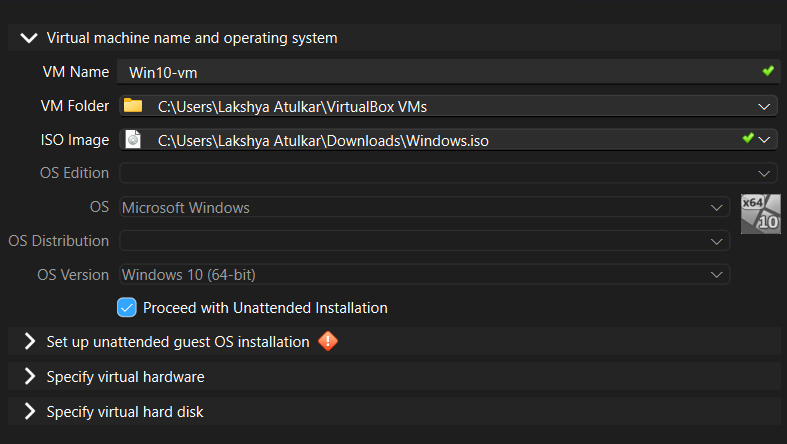
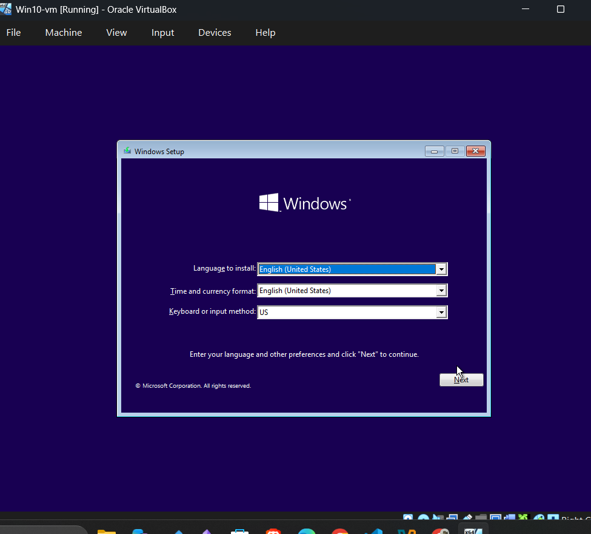
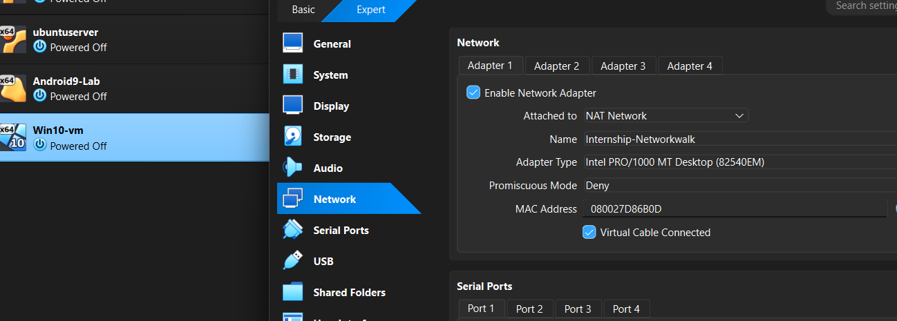
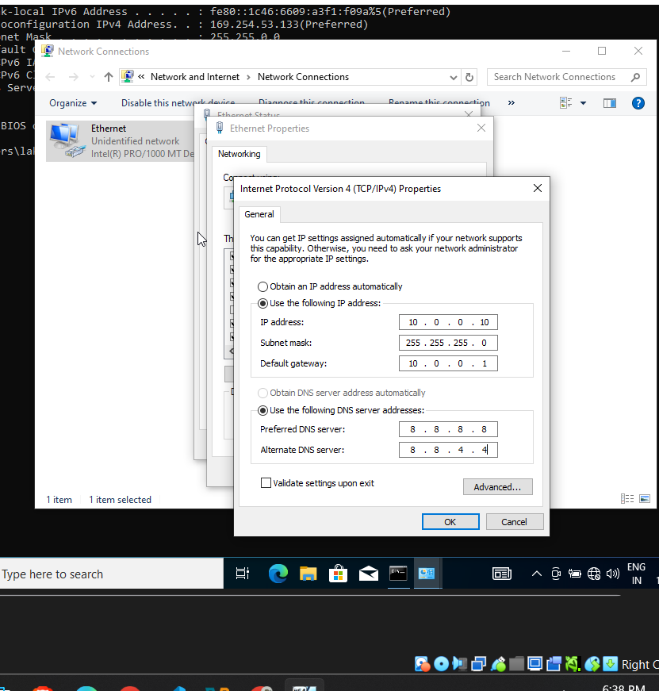
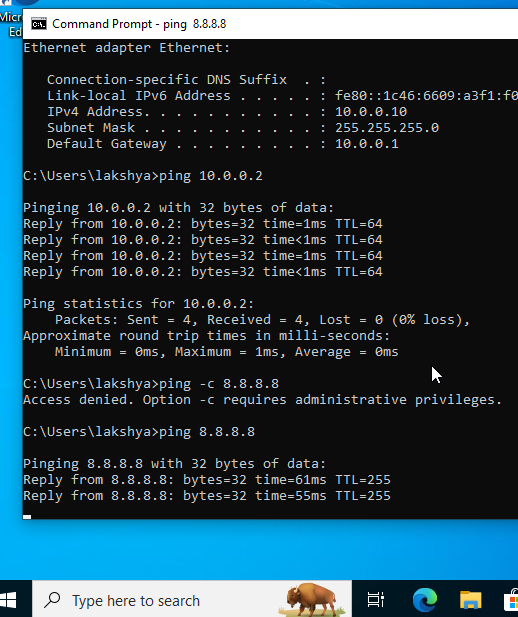
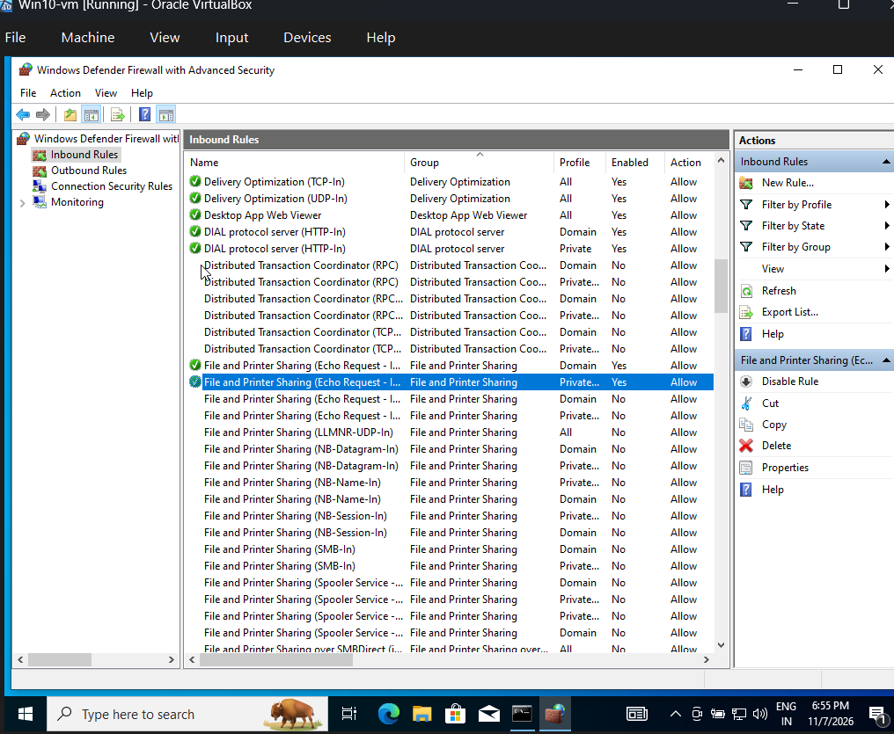
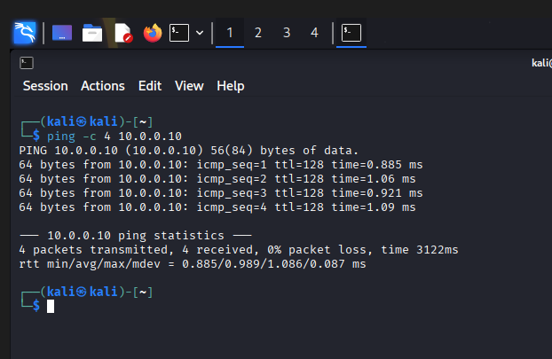

# WK1-PMx – Windows 10 VirtualBox Setup & Network Connectivity Lab


## 1. Project Overview

This practical involved installing Windows 10 inside Oracle VirtualBox, connecting it to the same NAT Network as an existing Kali Linux virtual machine, configuring static IPv4 addressing, and establishing bidirectional network communication.

The objective was to build a small virtual networking environment and verify connectivity between two different operating systems.

### Objectives

- Install Windows 10 Pro in VirtualBox.
- Configure a shared NAT Network.
- Assign static IPv4 addresses.
- Configure gateway and DNS settings.
- Test internet connectivity.
- Establish communication between Kali Linux and Windows.
- Configure Windows Defender Firewall to allow incoming ICMPv4 Echo Requests.

## 2. Lab Environment

| Component | Configuration |
|---|---|
| Virtualization | Oracle VirtualBox |
| Host OS | Windows |
| Linux VM | Kali Linux |
| Windows VM | Windows 10 Pro |
| RAM | 4096 MB |
| CPU | 2 Cores |
| Virtual Disk | 40 GB |
| Disk Format | VDI |
| Network Type | NAT Network |
| Network Name | Internship-Networkwalk |

## 3. Network Architecture

Both virtual machines were connected to the same VirtualBox NAT Network.

| Configuration | Kali Linux | Windows 10 |
|---|---|---|
| IPv4 Address | 10.0.0.2 | 10.0.0.10 |
| Subnet Mask | 255.255.255.0 | 255.255.255.0 |
| Default Gateway | 10.0.0.1 | 10.0.0.1 |
| DNS | Network-provided | 8.8.8.8 |

**Network Address:** `10.0.0.0/24`

## 4. Implementation – Step by Step

### Step 1: Download Windows 10 ISO

Downloaded the Windows 10 ISO using Microsoft's official Media Creation Tool.

Official download: https://www.microsoft.com/software-download/windows10

Procedure:

1. Downloaded and executed `MediaCreationTool.exe`.
2. Accepted the Microsoft license terms.
3. Selected Create installation media for another PC.
4. Selected the required language and Windows 10 edition.
5. Selected 64-bit (x64) architecture.
6. Selected ISO File.
7. Saved the ISO as `Windows.iso`.

### Step 2: Create Windows 10 Virtual Machine

Created a new virtual machine using Oracle VirtualBox.

Configuration:

| Setting | Value |
|---|---|
| VM Name | Win10-vm |
| Type | Microsoft Windows |
| Version | Windows 10 (64-bit) |
| ISO | Windows.iso |
| RAM | 4096 MB |
| CPU | 2 |
| Virtual Disk | 40 GB |
| Disk Format | VDI |
| Allocation | Dynamically Allocated |

Selected manual installation instead of Unattended Installation.

**Screenshot – Virtual Machine Creation**



### Step 3: Install Windows 10

Started the VM and followed the Windows installation wizard.

1. Selected language and keyboard preferences.
2. Selected Install Now.
3. Selected I don't have a product key.
4. Selected Windows 10 Pro (64-bit).
5. Accepted the license terms.
6. Selected Custom: Install Windows only (advanced).
7. Selected the 40 GB virtual hard disk.
8. Completed the Windows installation.

**Screenshot – Windows Installation**



### Step 4: Configure VirtualBox NAT Network

Before starting the VM, configured its network adapter.

Procedure:

1. Selected `Win10-vm` in VirtualBox Manager.
2. Opened Settings.
3. Selected Network.
4. Opened Adapter 1.
5. Enabled Network Adapter.
6. Selected NAT Network under Attached to.
7. Selected the existing network `Internship-Networkwalk`.
8. Enabled Virtual Cable Connected.
9. Saved the configuration.

Network Adapter Configuration:

| Setting | Value |
|---|---|
| Adapter | Adapter 1 |
| Attached To | NAT Network |
| Network Name | Internship-Networkwalk |
| Adapter Type | Intel PRO/1000 MT Desktop |
| Virtual Cable Connected | Enabled |

**Screenshot – NAT Network Configuration**



### Step 5: Inspect Windows Network Configuration

After Windows installation, opened Command Prompt using:

**Keyboard Shortcut:** `Windows + R`

Entered:

```text
cmd
```

Executed:

```cmd
ipconfig
```

For detailed network information, executed:

```cmd
ipconfig /all
```

Initially, Windows received an APIPA address:

| Parameter | Initial Value |
|---|---|
| IPv4 Address | 169.254.53.133 |
| Subnet Mask | 255.255.0.0 |
| Default Gateway | Blank |

An APIPA address (`169.254.x.x`) is automatically assigned when Windows does not obtain an IPv4 address through DHCP.

Therefore, a static IPv4 configuration was required for this practical.

### Step 6: Open Network Connections

Opened the Network Connections interface using:

**Keyboard Shortcut:** `Windows + R`

Entered:

```text
ncpa.cpl
```

This opens the Network Connections Control Panel.

Procedure:

1. Located the Ethernet adapter.
2. Right-clicked Ethernet.
3. Selected Properties.
4. Located Internet Protocol Version 4 (TCP/IPv4).
5. Double-clicked it to open IPv4 Properties.

### Step 7: Configure Static IPv4 Address

Selected:

**Use the following IP address**

Entered:

| Field | Value |
|---|---|
| IP Address | 10.0.0.10 |
| Subnet Mask | 255.255.255.0 |
| Default Gateway | 10.0.0.1 |

Under DNS configuration, selected:

**Use the following DNS server addresses**

Entered:

| Field | Value |
|---|---|
| Preferred DNS | 8.8.8.8 |
| Alternate DNS | 8.8.4.4 |

Clicked OK and Close.

**Screenshot – Windows IP Configuration**



### Step 8: Verify Static IP Configuration

Opened Command Prompt and executed:

```cmd
ipconfig
```

Verified:

```text
IPv4 Address      : 10.0.0.10
Subnet Mask       : 255.255.255.0
Default Gateway   : 10.0.0.1
```

The static IP configuration was successfully applied.

## 5. Network Connectivity Testing

### Step 9: Test Windows to Gateway

Executed:

```cmd
ping 10.0.0.1
```

Purpose: Verify communication between Windows and the NAT Network gateway.

Result:

- Packets Sent: 4
- Packets Received: 4
- Packet Loss: 0%

**Status: PASS**

### Step 10: Test Windows Internet Connectivity

Executed:

```cmd
ping 8.8.8.8
```

Purpose: Verify external network connectivity using Google Public DNS.

Result:

- Packets Sent: 4
- Packets Received: 4
- Packet Loss: 0%
- Average Response Time: Approximately 59 ms

**Status: PASS**

### Step 11: Test Windows to Kali Linux

Executed:

```cmd
ping 10.0.0.2
```

Purpose: Verify connectivity from Windows 10 to Kali Linux.

Result:

- Packets Sent: 4
- Packets Received: 4
- Packet Loss: 0%

**Status: PASS**

**Screenshot – Windows to Kali Ping**



## 6. Troubleshooting – Kali to Windows Communication

### Step 12: Inspect Kali Linux Network Interface

Opened the Kali Linux terminal and executed:

```bash
ip -br addr
```

Purpose: Display network interfaces and their IP addresses in a brief format.

Observed configuration:

```text
lo      UNKNOWN    127.0.0.1/8
eth0    UP         10.0.0.2/24
```

This confirmed that the Kali Ethernet interface was active and had the expected IP address.

### Step 13: Perform Initial Kali to Windows Ping

Executed:

```bash
ping -c 4 10.0.0.10
```

Initial result:

```text
4 packets transmitted
0 received
100% packet loss
```

**Issue identified:** Kali Linux could not receive ICMP Echo Replies from Windows 10.

Windows could already ping Kali successfully, so the investigation focused on Windows inbound firewall filtering.

## 7. Windows Defender Firewall Configuration

### Step 14: Open Windows Defender Firewall with Advanced Security

Inside Windows 10, pressed:

**Keyboard Shortcut:** `Windows + R`

Entered:

```text
wf.msc
```

This opens Windows Defender Firewall with Advanced Security.

The console provides access to:

- Inbound Rules
- Outbound Rules
- Connection Security Rules
- Firewall profiles
- Network traffic filtering

### Step 15: Enable ICMPv4 Echo Request Inbound Rule

Procedure:

1. Selected Inbound Rules.
2. Located:

   `File and Printer Sharing (Echo Request - ICMPv4-In)`

3. Identified the appropriate network profile.
4. Enabled the applicable ICMPv4 Echo Request inbound rule.
5. Verified that the rule was enabled and its action was Allow.

**Why was this required?**

When Kali sends a ping request to Windows:

1. Kali sends an ICMP Echo Request.
2. Windows receives the request.
3. Windows Defender Firewall checks its inbound rules.
4. If permitted, Windows sends an ICMP Echo Reply.
5. Kali receives the response.

The appropriate firewall rule allowed incoming ping requests without disabling the entire firewall.

**Screenshot – Firewall ICMP Configuration**



## 8. Final Bidirectional Connectivity Verification

### Step 16: Kali Linux to Windows 10

Returned to Kali Linux and executed:

```bash
ping -c 4 10.0.0.10
```

Successful result:

```text
64 bytes from 10.0.0.10:
icmp_seq=1 ttl=128 time=0.885 ms

64 bytes from 10.0.0.10:
icmp_seq=2 ttl=128 time=1.06 ms

64 bytes from 10.0.0.10:
icmp_seq=3 ttl=128 time=0.921 ms

64 bytes from 10.0.0.10:
icmp_seq=4 ttl=128 time=1.09 ms
```

Final statistics:

```text
4 packets transmitted
4 received
0% packet loss
```

**Status: PASS**

**Screenshot – Kali to Windows Ping**



### Step 17: Windows 10 to Kali Linux

Returned to Windows Command Prompt and executed:

```cmd
ping 10.0.0.2
```

Result:

- Packets Sent: 4
- Packets Received: 4
- Packet Loss: 0%

**Status: PASS**

## 9. Final Verification Results

| Connectivity Test | Source | Destination | Result |
|---|---|---|---|
| Gateway | Windows | 10.0.0.1 | PASS |
| Internet | Windows | 8.8.8.8 | PASS |
| VM Communication | Windows | 10.0.0.2 | PASS |
| Reverse VM Communication | Kali | 10.0.0.10 | PASS |

## 10. Skills and Concepts Practiced

**Virtualization**
- Oracle VirtualBox
- Virtual Machine Creation
- Windows Installation
- Virtual Disk Configuration
- Network Adapter Configuration

**Networking**
- IPv4 Addressing
- Subnet Masks
- Static IP Configuration
- Default Gateway
- DNS Configuration
- NAT Networking
- ICMP and Ping

**Windows Administration**
- Command Prompt
- Network Connections
- Windows Defender Firewall
- Inbound Firewall Rules
- ICMPv4 Echo Requests

**Linux Administration**
- Kali Linux
- Network Interface Inspection
- IP Address Verification
- Connectivity Testing

**Troubleshooting**
- APIPA Address Diagnosis
- Network Connectivity Testing
- Firewall Rule Analysis
- Bidirectional Communication Verification

## 11. Conclusion

Successfully created and deployed a Windows 10 Pro virtual machine alongside Kali Linux using Oracle VirtualBox.

Configured both systems on the same NAT Network, assigned static IPv4 addresses, configured the gateway and DNS, and verified internet connectivity.

During testing, identified and resolved an inbound ICMP connectivity issue through Windows Defender Firewall configuration.

Finally, established successful bidirectional network communication between Kali Linux and Windows 10 with zero packet loss.

This practical provided hands-on experience in virtualization, network configuration, Windows administration, Linux networking, firewall management, and network troubleshooting.

---

**Practical ID:** WK1-PMx  
**Project:** Week 1 Extra Project – Windows 10 VirtualBox Setup  
**Environment:** Oracle VirtualBox | Kali Linux | Windows 10 Pro  
**Status:** Successfully Completed