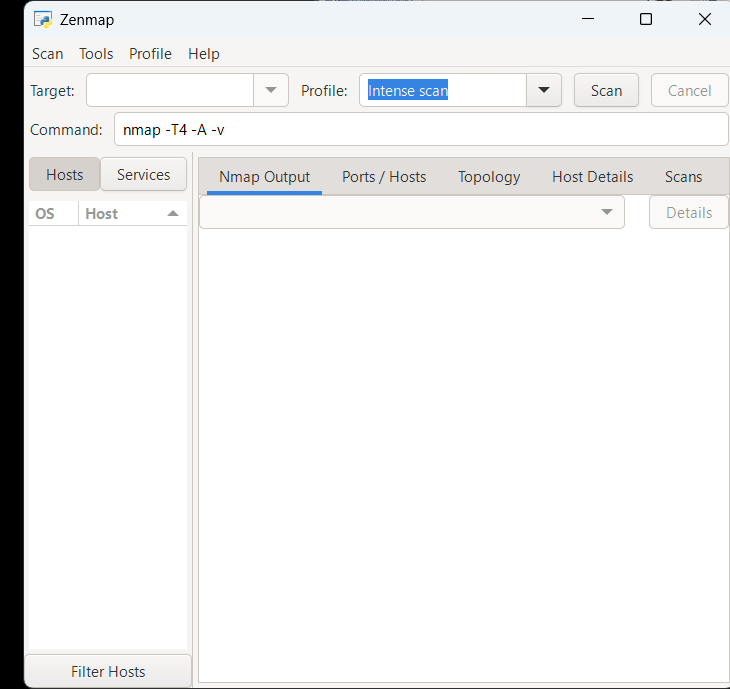
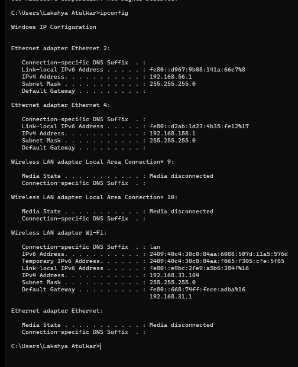
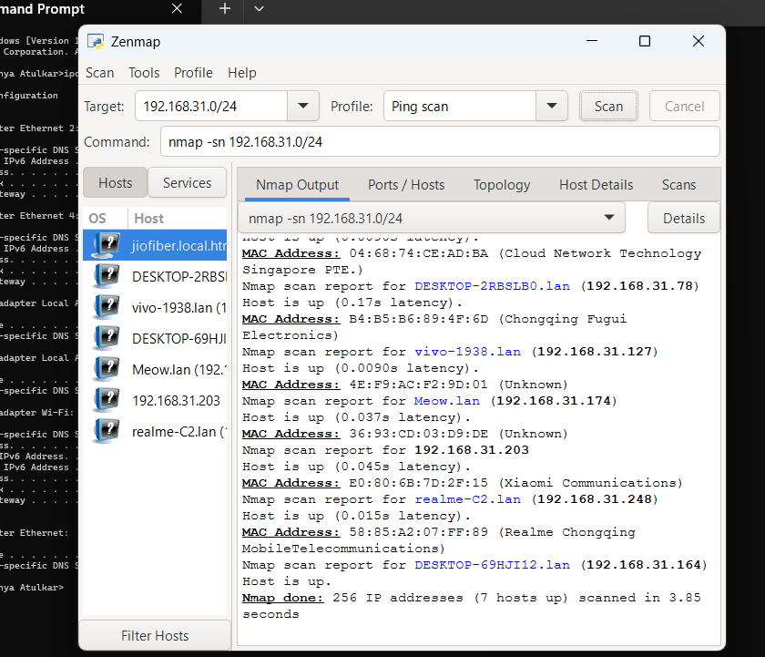
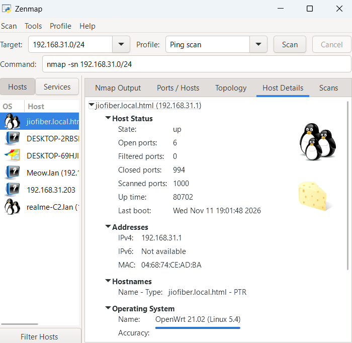
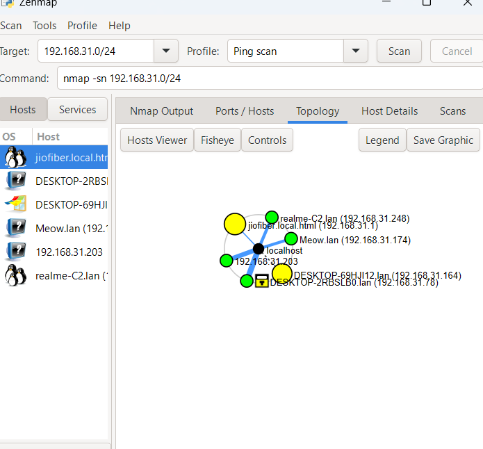
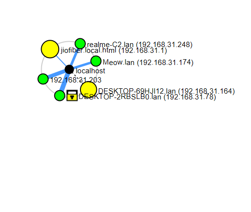

# Week 02 – Project Module 5: Network Scanning Using Zenmap

## Project Overview

This practical focuses on network discovery and scanning using Zenmap, the graphical user interface for Nmap (Network Mapper).

The objective is to identify active devices on a local network, analyze their IP and MAC addresses, inspect available host information, and visualize the discovered network through a topology graph.

The practical was performed on a Windows host connected to a Wi-Fi network using Zenmap.

**Internship:** NetworkWalks  
**Week:** 02  
**Project Module:** W2-PM5  
**Category:** Cybersecurity & Networking  
**Operating System:** Windows  
**Tool:** Zenmap (Nmap GUI)  
**Network Interface:** Wi-Fi

---

## Objectives

- Install and configure Zenmap on Windows.
- Identify the local IPv4 address and subnet mask.
- Calculate the network subnet.
- Discover active hosts on the local network.
- Count the number of discovered live hosts.
- Identify IP addresses and MAC addresses of available devices.
- Inspect host information and operating system details.
- Generate and save a network topology visualization.

---

## Tools & Technologies Used

| Tool / Technology | Purpose |
|---|---|
| Zenmap | Graphical network scanning interface |
| Nmap | Network discovery and scanning engine |
| Windows CMD | Network configuration |
| ipconfig | IP and subnet identification |
| Ping Scan | Live host discovery |
| VirtualBox | Virtualization environment used in other internship practicals |

---

## Practical Implementation

### 1. Installation of Zenmap

**Objective:** Install Zenmap on Windows to perform graphical network scanning and host discovery.

**Download Source:**

https://nmap.org/download.html

**Installation Steps:**

1. Open the official Nmap download page.
2. Download the Windows self-installer.
3. Execute the installer.
4. Complete the installation process.
5. Launch Zenmap from the Windows Start menu.

**Observation:**

Zenmap was successfully installed and launched on the Windows system. The application interface displayed the Target field, Profile selection, Command field, Nmap Output, Hosts, Services, and Topology tabs.

**Outcome:** Successfully installed and configured Zenmap for network scanning activities.

**Screenshot:**



---

### 2. Identifying Local IP Address and Network Configuration

**Objective:** Identify the active network interface, IPv4 address, subnet mask, and default gateway.

**Command Executed:**

```cmd
ipconfig
```

**Active Network Adapter:** Wireless LAN adapter Wi-Fi

**Observed Network Configuration:**

| Parameter | Observed Value |
|---|---|
| IPv4 Address | 192.168.31.164 |
| Subnet Mask | 255.255.255.0 |
| Default Gateway | 192.168.31.1 |
| DNS Suffix | lan |

**Subnet Calculation:**

The subnet mask `255.255.255.0` represents a `/24` network prefix.

Therefore, the identified network subnet was:

```text
192.168.31.0/24
```

**Network Address Information:**

- Network Address: 192.168.31.0
- Host IP Address: 192.168.31.164
- Default Gateway: 192.168.31.1
- Broadcast Address: 192.168.31.255
- Usable Host Range: 192.168.31.1 – 192.168.31.254

Additional virtual Ethernet adapters were also visible in the command output but were not used for this practical.

**Outcome:** Successfully identified the active Wi-Fi network configuration and calculated the LAN subnet.

**Screenshot:**



---

### 3. Network Discovery Using Ping Scan

**Objective:** Discover active devices connected to the local network.

**Target Network:**

```text
192.168.31.0/24
```

**Zenmap Profile:** Ping Scan

**Command Executed:**

```bash
nmap -sn 192.168.31.0/24
```

**Command Explanation:**

- `nmap`: Launches the Nmap network scanning engine.
- `-sn`: Performs host discovery without a port scan.
- `192.168.31.0/24`: Specifies the target network subnet.

**Observations:**

The scan successfully identified seven live hosts across 256 scanned IP addresses.

| Parameter | Result |
|---|---|
| Target Network | 192.168.31.0/24 |
| Total IP Addresses Scanned | 256 |
| Live Hosts Discovered | 7 |
| Scan Duration | 3.85 seconds |
| Scan Status | Completed |

**Outcome:** Successfully discovered seven active hosts on the local network using Zenmap's Ping Scan profile.

**Screenshot:**



---

### 4. Counting and Identifying Live Hosts

**Objective:** Analyze the Ping Scan output and identify the number of active devices.

**Observation:**

The Nmap output reported:

```text
Nmap done: 256 IP addresses (7 hosts up)
```

The following devices were visible in the discovered host list:

| Hostname / Device | IP Address |
|---|---|
| jiofiber.local.html | 192.168.31.1 |
| DESKTOP-2RBSLB0.lan | 192.168.31.78 |
| vivo-1938.lan | 192.168.31.127 |
| Meow.lan | 192.168.31.174 |
| Unnamed Host | 192.168.31.203 |
| realme-C2.lan | 192.168.31.248 |
| DESKTOP-69HJI12.lan | 192.168.31.164 |

**Outcome:** Successfully counted and identified seven live hosts from the network discovery results.

---

### 5. Identifying IP Addresses and MAC Addresses

**Objective:** Examine the discovered hosts and identify their corresponding IP addresses and MAC addresses where available.

**Methodology:**

1. Open the completed scan results in Zenmap.
2. Select an individual host from the Hosts panel.
3. Open the Host Details tab.
4. Examine the Addresses and Hostnames sections.
5. Observe the available MAC address and vendor information.

**Observed Host Information:**

The selected gateway device displayed the following information:

| Parameter | Result |
|---|---|
| Hostname | jiofiber.local.html |
| IPv4 Address | 192.168.31.1 |
| MAC Address | 04:68:74:CE:AD:BA |
| Host Status | Up |
| Operating System | OpenWrt 21.02 |
| Kernel | Linux 5.4 |

**Additional Observations:**

The host details pane displayed:

- Open Ports: 6
- Filtered Ports: 0
- Closed Ports: 994
- Scanned Ports: 1000

The initial Intense Scan output also showed ports 80, 443, and 8080 as open on the gateway.

These port and operating system observations are separate from the Ping Scan, which was used for host discovery without port scanning.

**Outcome:** Successfully inspected host details, IP addresses, MAC address information, and available operating system identification.

**Screenshot:**



---

### 6. Network Topology Generation

**Objective:** Generate a visual representation of the discovered network devices and their connections using Zenmap.

**Methodology:**

1. Open the completed scan results in Zenmap.
2. Navigate to the Topology tab.
3. Observe the discovered network nodes.
4. Examine the visual relationships between the scanning system and discovered hosts.
5. Use the Save Graphic option to export the topology visualization.
6. Save the exported graphic in the project directory.

**Observed Network Information:**

The topology visualization displayed the following devices:

- Local gateway: 192.168.31.1
- Windows laptop: 192.168.31.164
- Additional discovered hosts: 192.168.31.78, 192.168.31.127, 192.168.31.174, 192.168.31.203, and 192.168.31.248.

**Outcome:** Successfully generated and exported a network topology visualization representing the discovered devices.

**Topology Screenshot:**



**Exported Network Topology:**



---

## 📊 Summary of Results

| Practical | Result |
|---|---|
| Zenmap Installation | Successfully installed and launched |
| IP Configuration | Identified IPv4, subnet mask and gateway |
| Ping Scan | Successfully completed |
| Host Discovery | 7 live hosts identified |
| IP Identification | IP addresses identified for discovered hosts |
| MAC Identification | MAC address information retrieved where available |
| Network Topology | Topology generated and exported as PNG |

---

## 🔐 Security Relevance

Network scanning and host discovery are important activities in network security assessments.

They help security professionals understand the devices present on a network and identify the available network infrastructure.

This practical demonstrated how Zenmap and Nmap can be used to:

- Discover active hosts on a local network.
- Identify network devices using IP addresses.
- Retrieve MAC addresses and vendor information where available.
- Inspect available host information.
- Visualize discovered network devices through topology mapping.

Network discovery provides useful information for network inventory, infrastructure monitoring, and authorized security assessments.

---

## 📚 Key Learnings

Through this practical, I gained hands-on experience with:

- Installing and using Zenmap on Windows.
- Understanding Nmap and its graphical interface.
- Identifying IPv4 addresses and subnet masks.
- Calculating network addresses using CIDR notation.
- Understanding Ping Scan and the `-sn` option.
- Discovering live hosts on a local network.
- Identifying IP and MAC addresses.
- Understanding basic host and operating system information.
- Generating and exporting network topology graphs.
- Organizing technical screenshots and practical evidence.

---

## ⚠️ Disclaimer

This practical was performed on my personal Wi-Fi network for educational purposes as part of the NetworkWalks cybersecurity internship.

Network discovery and scanning activities were performed within the authorized scope of the practical.

The information collected is intended for educational documentation and network analysis. No exploitation or unauthorized access was performed.

---

## 📁 Project Structure

```text
PM5 - Network scanning with Zenmap/
│
├── screenshots/
│   ├── 01-zenmap-installation.png
│   ├── 02-ipconfig.png
│   ├── 03-ping-scan.png
│   ├── 04-host-details.png
│   └── 05-network-topology.png
│
├── topology/
│   └── network-topology.png
│
└── README.md
```

---

**Internship:** NetworkWalks  
**Week:** 02  
**Project Module:** PM5 – Network Scanning with Zenmap  
**Status:** Completed