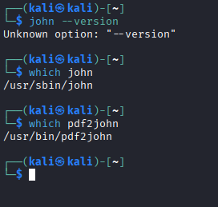
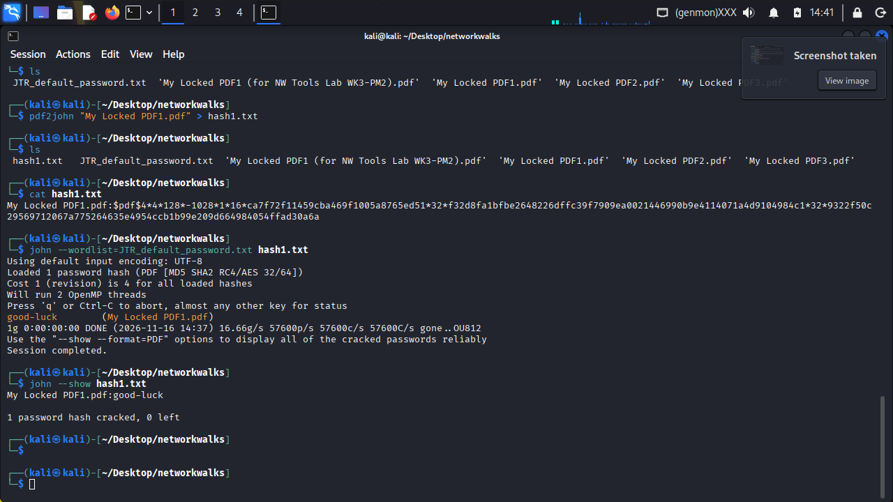
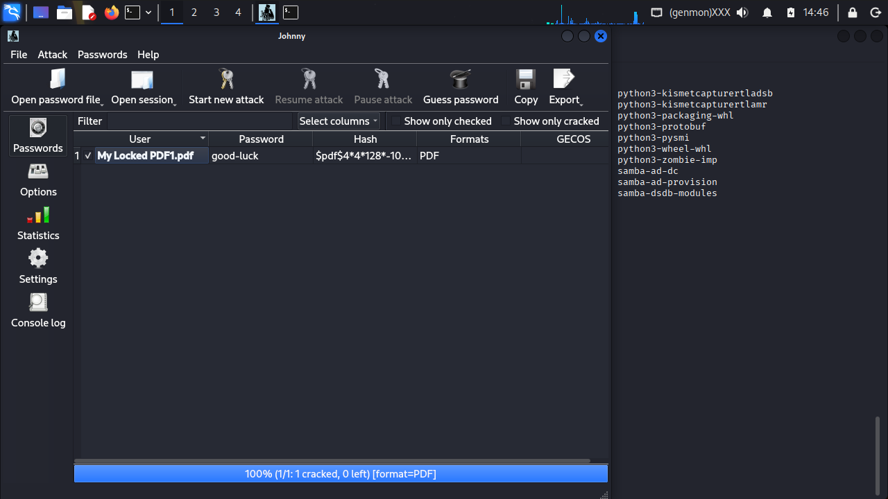

# Week 03 – PM1: Password Cracking with John the Ripper

## 1. Project Overview

This project was completed as part of the NetworkWalks Cybersecurity Internship (Batch B084).

The objective was to understand and perform password recovery on an assigned password-protected PDF using **John the Ripper (JTR)** and its graphical frontend **Johnny**.

The practical demonstrates how password hashes can be extracted from protected PDF files and tested against candidate passwords using a dictionary attack.

## 2. Objectives

- Understand password hashing and dictionary attacks.
- Install and verify John the Ripper in Kali Linux.
- Extract a PDF password hash using `pdf2john`.
- Perform a dictionary attack using a provided wordlist.
- Verify the recovered password.
- Explore Johnny, the graphical frontend for John the Ripper.
- Document the practical workflow and results.

## 3. Lab Environment

| Component | Details |
|---|---|
| Operating System | Kali Linux |
| Virtualization | Oracle VirtualBox |
| Password Recovery Tool | John the Ripper |
| GUI Frontend | Johnny |
| Hash Extraction Tool | pdf2john |
| Attack Type | Dictionary Attack |
| Target File | My Locked PDF1.pdf |
| Wordlist | JTR_default_password.txt |

## 4. Tools Used

### John the Ripper

John the Ripper is an open-source password security auditing and recovery tool. It supports multiple hash formats and password recovery techniques.

### pdf2john

A utility included with John the Ripper Jumbo that extracts password-verification data from password-protected PDF files into a format that John can process.

### Johnny

Johnny is a graphical user interface for John the Ripper. It provides a visual way to manage password files, configure attacks, and inspect results.

### Wordlist

A wordlist is a collection of candidate passwords used during dictionary attacks.

The supplied `JTR_default_password.txt` file was used in this practical.

## 5. Practical Implementation

### Step 1: Verify John the Ripper Installation

Command:

```bash
john --list=build-info
```

John the Ripper was successfully verified.

Version:

```text
1.9.0-jumbo-1+bleeding-aec1328d6c
```

### Step 2: Verify Required Tools

```bash
which john
which pdf2john
```

Both utilities were available in Kali Linux.

### Step 3: Prepare Lab Files

The following files were downloaded into the lab directory:

- My Locked PDF1.pdf
- JTR_default_password.txt

### Step 4: Extract the PDF Hash

Command:

```bash
pdf2john "My Locked PDF1.pdf" > hash1.txt
```

Explanation:

- `pdf2john` extracts the PDF password hash.
- The quoted filename specifies the target PDF.
- `>` redirects the extracted output into `hash1.txt`.

The extracted hash was verified using:

```bash
cat hash1.txt
```

### Step 5: Perform Dictionary Attack

Command:

```bash
john --wordlist=JTR_default_password.txt hash1.txt
```

Explanation:

- `john` starts the password recovery process.
- `--wordlist` specifies the dictionary file.
- `hash1.txt` contains the extracted PDF hash.

John tested candidate passwords from the supplied dictionary and successfully recovered the password.

### Step 6: Display Recovered Password

Command:

```bash
john --show hash1.txt
```

Result:

```text
My Locked PDF1.pdf:good-luck

1 password hash cracked, 0 left
```

**Result:** Password successfully recovered.

### Step 7: Verify PDF Access

The recovered password was used to open the protected PDF.

The PDF opened successfully and displayed the assigned flag-capture confirmation.

### Step 8: Johnny GUI Demonstration

Johnny was installed and launched in Kali Linux.

The extracted `hash1.txt` file was opened in Johnny.

The GUI identified the hash format as PDF and displayed the recovered password.

Observed result:

```text
Password: good-luck
Format: PDF
Progress: 100%
Hashes cracked: 1/1
Remaining: 0
```

## 6. Final Results

| Task | Result |
|---|---|
| John installation | Successful |
| pdf2john verification | Successful |
| PDF hash extraction | Successful |
| Dictionary attack | Successful |
| Password recovery | Successful |
| PDF access verification | Successful |
| Johnny GUI verification | Successful |

**Recovered Password:** `good-luck`

## 7. Screenshots and Evidence

The following screenshots document the practical:









## 8. Key Learnings

Through this practical, I learned:

- How password-protected PDFs store password-verification information.
- How to extract PDF hashes using pdf2john.
- How dictionary attacks work.
- How John the Ripper processes candidate passwords.
- How to use wordlists for password recovery.
- How to verify recovered passwords.
- How graphical interfaces such as Johnny interact with John the Ripper.

An important takeaway was understanding that a password hash is not the original password. The recovery tool tests candidate passwords against the extracted hash.

## 9. Conclusion

This practical provided hands-on experience with password recovery using John the Ripper and Johnny in Kali Linux.

I successfully extracted the password hash from the assigned PDF, performed a dictionary attack using the provided wordlist, recovered the correct password, and verified access to the protected document.

The exercise improved my understanding of password security, hash extraction, dictionary attacks, and Linux-based cybersecurity tools.

---

**Internship:** NetworkWalks Cybersecurity Internship  
**Batch:** B084  
**Week:** 03  
**Project Module:** PM1 – Password Cracking with John the Ripper  
**Status:** Completed
