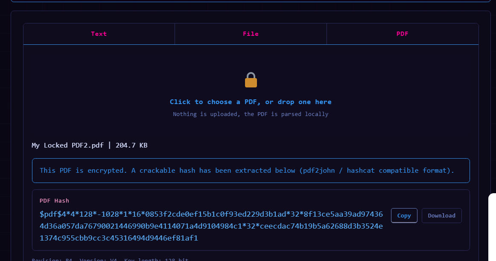
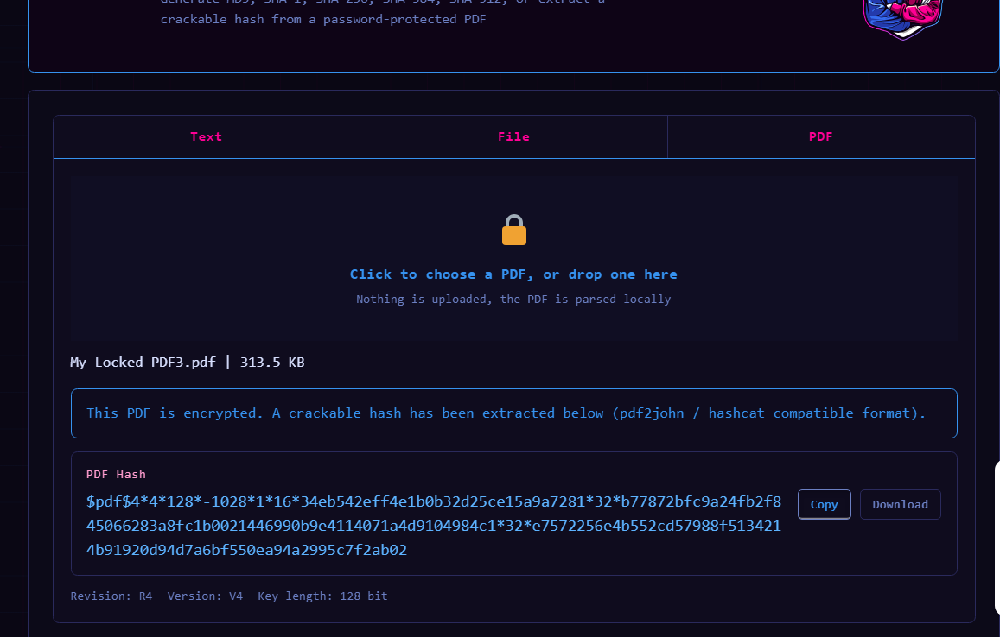

# Week 03 – PM2: Password Cracking with NetworkWalks Tools

## 1. Project Overview

This practical was completed as part of the NetworkWalks Cybersecurity Internship (Batch B084).

The objective was to understand PDF password hash extraction and password recovery using NetworkWalks online security tools.

Unlike PM1, where John the Ripper was used locally in Kali Linux, this practical involved using NetworkWalks tools to extract and process password hashes.

## 2. Objectives

- Understand PDF password protection and password hashes.
- Learn how PDF hashes are extracted.
- Explore NetworkWalks Hash Calculator.
- Use NetworkWalks Password Cracker.
- Understand the password recovery process.
- Successfully recover the assigned training PDF passwords.
- Capture and document the flags obtained during the exercise.

## 3. Lab Environment

| Component | Details |
|---|---|
| Operating System | Kali Linux |
| Virtualization | Oracle VirtualBox |
| Browser | Mozilla Firefox |
| Hash Extraction | NetworkWalks Hash Calculator |
| Password Recovery | NetworkWalks Password Cracker |
| Target File | My Locked PDF1 (for NW Tools Lab WK3-PM2).pdf |
| Practical Type | PDF Password Recovery |

## 4. Tools Used

### 4.1 NetworkWalks Hash Calculator

The Hash Calculator was used to process the assigned password-protected PDF and extract its password hash.

Website:
https://networkwalks.com/hash-calculator/

The generated PDF hash was used as input for the password recovery stage.

### 4.2 NetworkWalks Password Cracker

The Password Cracker was used to perform password recovery using the extracted hash and the available password-cracking functionality.

Website:
https://networkwalks.com/password-cracker/

## 5. Practical Implementation

### Step 1: Prepare the Lab Environment

- Started Kali Linux in Oracle VirtualBox.
- Opened Mozilla Firefox.
- Located the PM2-specific PDF provided in the internship resources.

Target file:

`My Locked PDF1 (for NW Tools Lab WK3-PM2).pdf`

### Step 2: Open NetworkWalks Hash Calculator

Opened the NetworkWalks Hash Calculator website.

Uploaded the assigned password-protected PDF.

The tool processed the document and generated the corresponding PDF password hash.

### Step 3: Extract the PDF Hash

The generated hash was obtained from the Hash Calculator.

PDF password hashes commonly use the `$pdf$` format in John the Ripper-compatible representations.

The extracted hash was used in the next stage.

### Step 4: Open NetworkWalks Password Cracker

Navigated to the NetworkWalks Password Cracker website.

Provided the required hash and followed the tool's password recovery workflow.

### Step 5: Perform Password Recovery

The password recovery process was performed using the NetworkWalks tool.

The tool processed the provided hash and recovered the assigned training PDF password(s).

### Step 6: Verify the Results and Capture Flags

After successful password recovery:

- Verified the recovered password(s).
- Opened the corresponding protected PDF documents.
- Located the assigned flags.
- Captured screenshots as practical evidence.

All assigned flag-capture tasks were completed successfully.

## 6. Results

| Task | Status |
|---|---|
| Kali Linux environment preparation | Completed |
| PDF selection and preparation | Completed |
| Hash Calculator access | Completed |
| PDF hash extraction | Completed |
| Password Cracker access | Completed |
| Password recovery | Completed |
| Flag identification | Completed |
| Screenshots and evidence | Completed |

**Overall Result: Successful**

## 7. Screenshots and Evidence

The following screenshots are maintained as evidence of the practical:

## 8. Key Learnings

Through this practical, I learned:

- How password-protected PDF documents use password-verification mechanisms.
- How PDF password hashes can be extracted.
- How online hash-processing tools work.
- How password recovery tools process extracted hashes.
- The importance of verifying recovered passwords.
- How to document practical cybersecurity exercises with screenshots and evidence.

I also understood the difference between using locally installed password recovery tools and web-based password recovery tools.

## 9. Conclusion

This practical provided hands-on experience with PDF password hash extraction and password recovery using NetworkWalks security tools.

I successfully completed the assigned password recovery exercises and captured the required flags.

The exercise improved my understanding of PDF password protection, hash extraction, password recovery workflows, and practical cybersecurity tooling.

---

**Internship:** NetworkWalks Cybersecurity Internship  
**Batch:** B084  
**Week:** 03  
**Project Module:** PM2 – Password Cracking with NetworkWalks Tools  
**Environment:** Kali Linux (Oracle VirtualBox)  
**Status:** Completed
